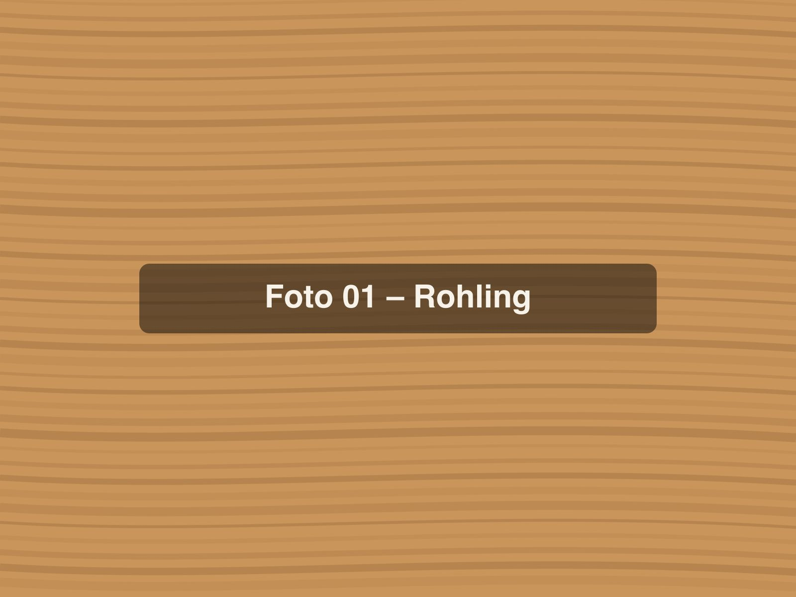
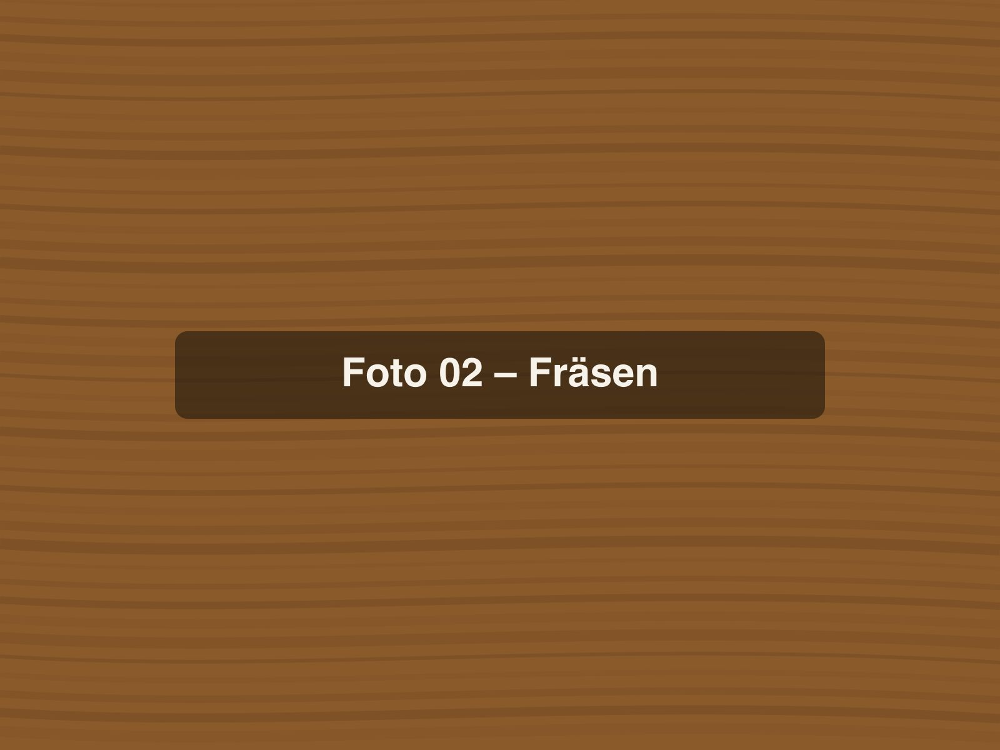

Hier steht die Geschichte des Projekts: Was wollte der Kunde, welche Besonderheiten gab es, wie wurde es umgesetzt?

## Die Fräsungen

Zwischenüberschriften, **Hervorhebungen** und Listen funktionieren wie gewohnt in Markdown:

- Kontur und Halstasche von oben
- E-Fach und Kabelkanal von hinten
- Binding-Nut mit einem 2-mm-Fräser

Zum Schluss ein paar Worte zum Ergebnis.
